# Demo - Student Information System (front-end showcase)

A sellable, front-end-only student portal for Philippine schools, built on the
**Paper & Clay** editorial design language: warm paper backgrounds, clay
accents, and a single Inter family for every typographic role (body, UI,
display, tabular data).

The app is a polished **product front-end** - every screen is driven by a
deterministic mock dataset (`src/data/student.ts`), no backend required.
Perfect for demos, pitch decks, and design reviews.

## Screenshots

Every screen of the demo at 1440px, in the order you&apos;ll meet them -
starting at the login page. All pages run on the fixed sample dataset.

| Login | Landing (`/about`) |
| --- | --- |
| 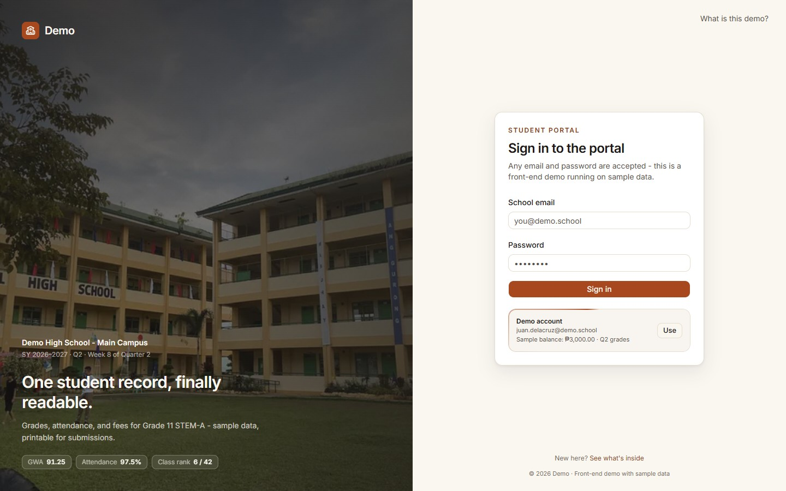 | 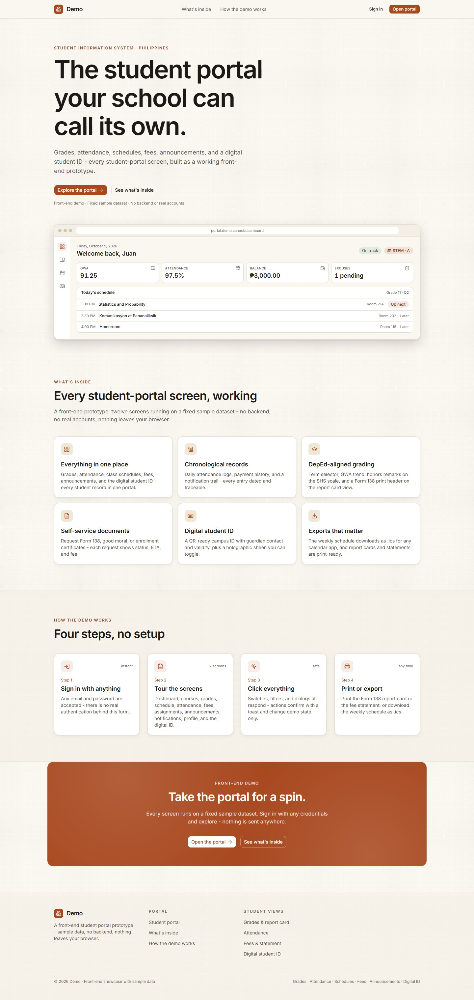 |

| Dashboard | Courses |
| --- | --- |
| 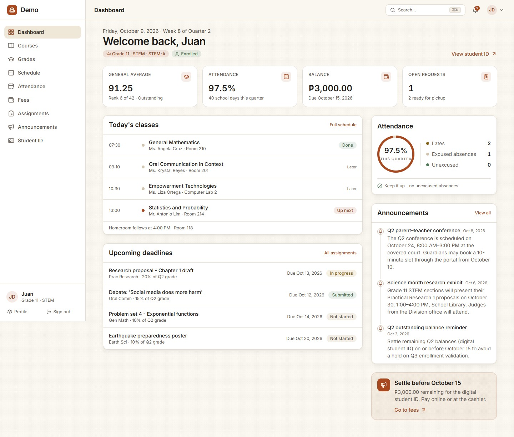 | 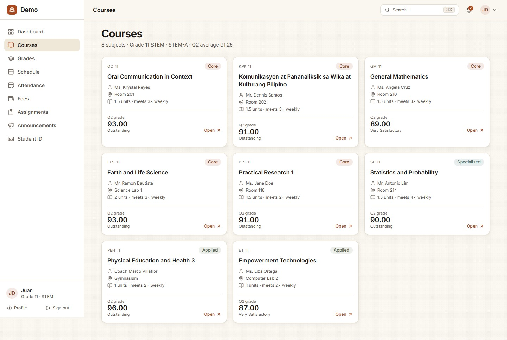 |

| Course detail | Grades |
| --- | --- |
| 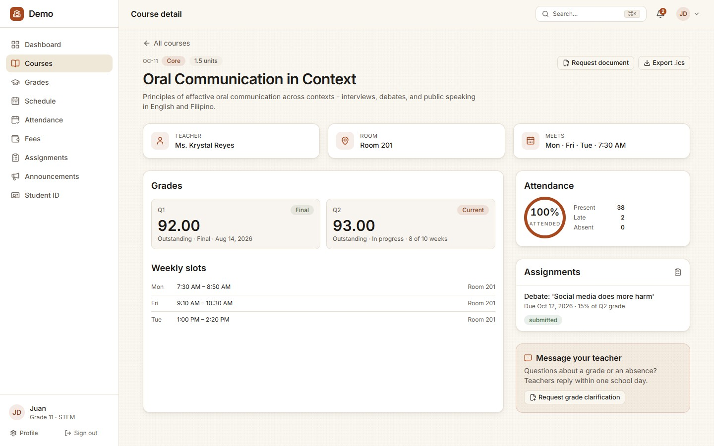 | 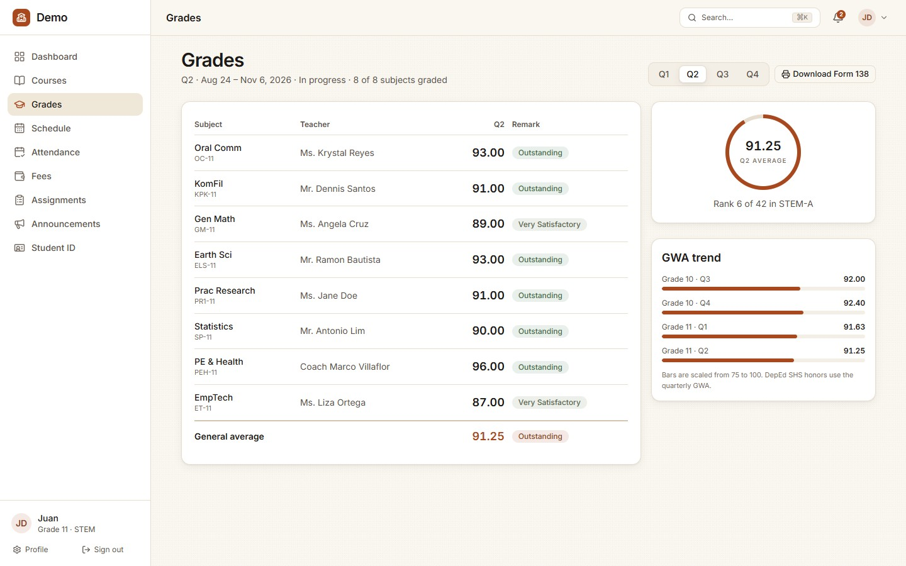 |

| Schedule | Attendance |
| --- | --- |
| 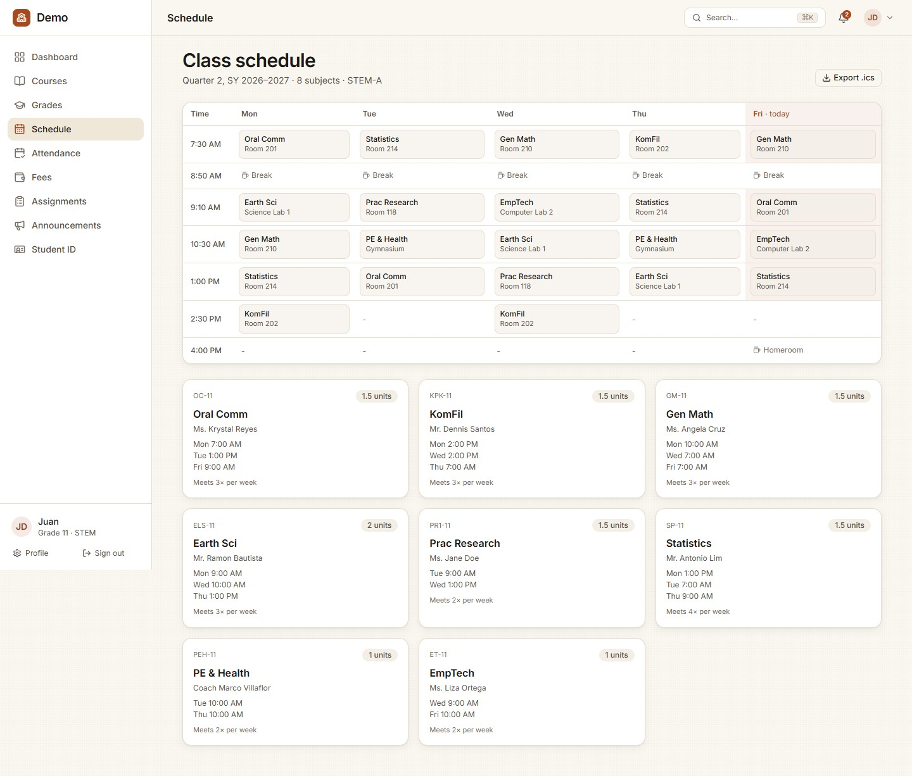 | 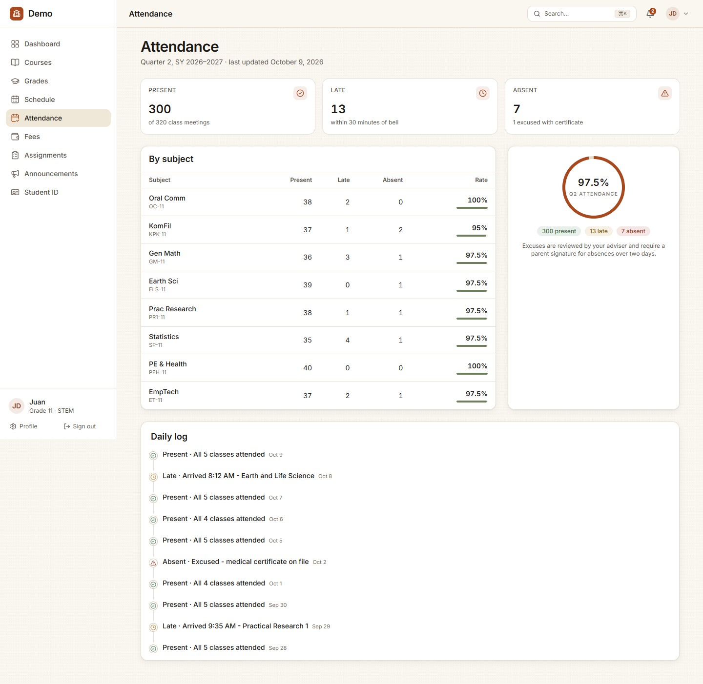 |

| Fees | Assignments |
| --- | --- |
| 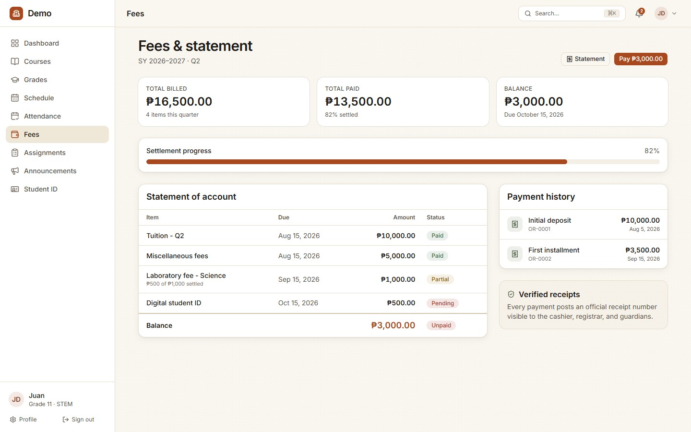 | 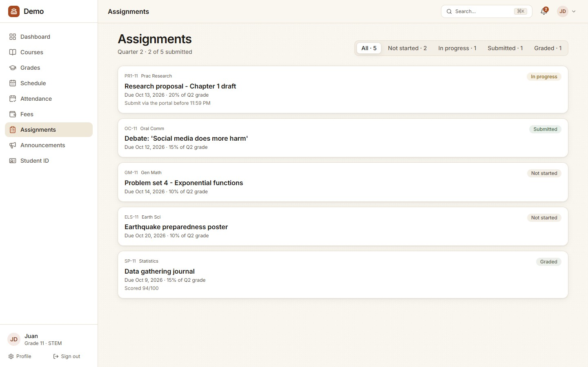 |

| Announcements | Notifications |
| --- | --- |
| 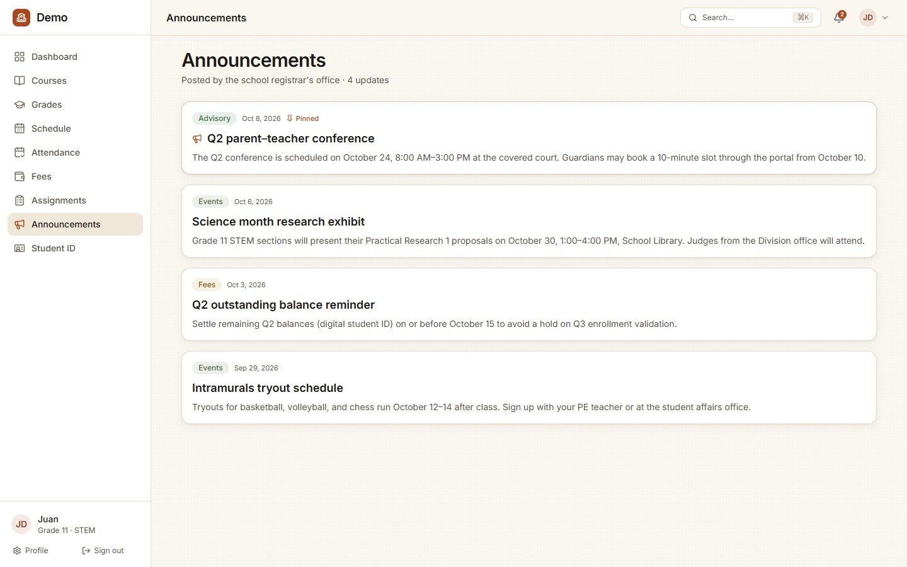 | 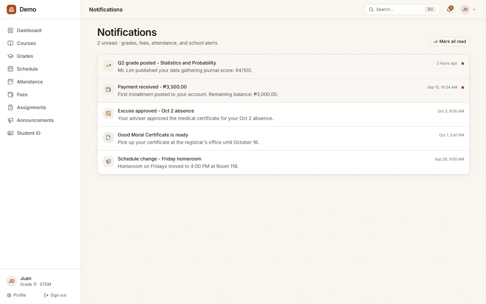 |

| Profile | Student ID |
| --- | --- |
| 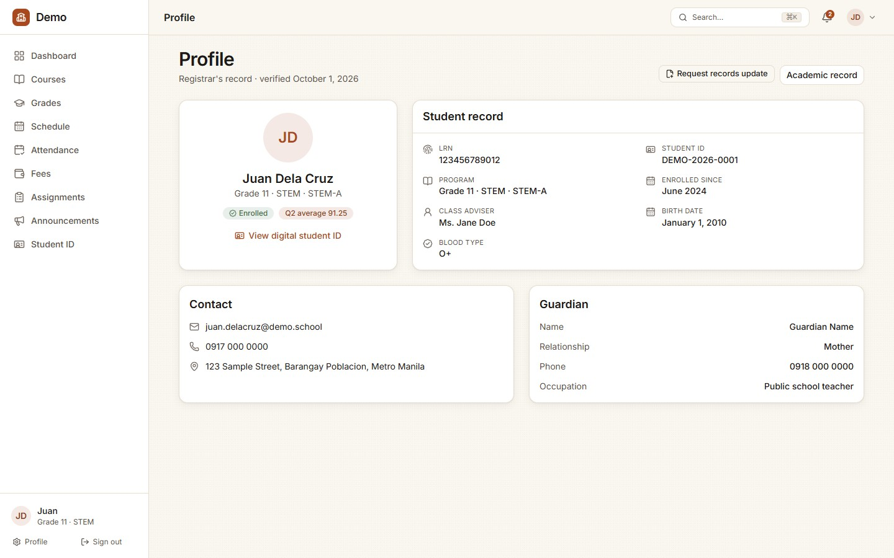 | 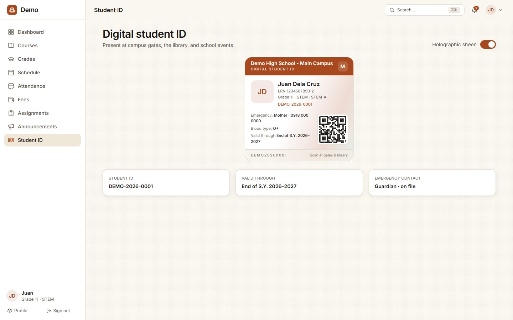 |

## Stack

| Layer      | Choice                                             |
| ---------- | -------------------------------------------------- |
| Framework  | Next.js 16.4 (App Router, Turbopack, Cache Components) |
| UI kit     | shadcn/ui (Base UI, "nova" preset) + Tailwind CSS v4 |
| Motion     | framer-motion + CSS scroll-driven reveals          |
| Icons      | lucide-react                                       |
| Fonts      | Inter (one variable family) - self-hosted via `next/font`            |
| Language   | TypeScript (strict), ESLint                        |

## Quick start

```bash
npm install
npm run dev        # http://localhost:3000 (port may shift if taken)
```

## Verification (run before every ship)

```bash
npx tsc --noEmit   # typecheck
npm run lint       # eslint
npm run build      # production build + prerender
```

## Demo login

`/login` - demo credentials are pre-filled in the panel (any values submit):

```
juan.delacruz@demo.school
demo1234
```

## Routes

| Route                      | What it is                                        |
| -------------------------- | ------------------------------------------------- |
| `/`                        | Redirects straight to `/login`                    |
| `/about`                   | Marketing landing (hero + product preview, stats, features, how it works, CTA) |
| `/login`                   | Campus-photo editorial sign-in with demo account     |
| `/portal/dashboard`        | Greeting, stat tiles, today's classes, deadlines, announcements |
| `/portal/courses`          | 8 Grade 11 STEM subjects                          |
| `/portal/courses/[id]`     | Course detail: grades, slots, attendance, assignments |
| `/portal/grades`           | Term selector, subject table, GWA ring + trend, Form 138 print header |
| `/portal/schedule`         | Weekly timetable (today highlighted) + .ics export |
| `/portal/attendance`       | Per-subject rates + daily log timeline            |
| `/portal/fees`             | Statement of account, payment history, pay dialog |
| `/portal/assignments`      | Filterable submission list                        |
| `/portal/announcements`    | School announcements (pinned first)               |
| `/portal/notifications`    | Alerts with read state                            |
| `/portal/profile`          | Registrar record, guardian, contact               |
| `/portal/id`               | Digital student ID: QR, emergency contact, holographic sheen |
| `/opengraph-image`         | Generated 1200×630 OG card                        |

Press <kbd>⌘K</kbd> (or <kbd>Ctrl K</kbd>) anywhere in the portal for the
command palette.

## Design language (Paper & Clay)

All tokens live in `src/app/globals.css` (`:root` + Tailwind v4 `@theme`):

| Token group        | Values                                                        |
| ------------------ | ------------------------------------------------------------- |
| Surfaces           | `--paper #FAF7F1`, `--surface #FFFFFF`, `--surface-2 #F4EFE6` |
| Text               | `--ink #1C1917`, `--ink-muted #57504A`, `--ink-faint #756B62` |
| Hairlines          | `--hairline #E6DDCF`, `--hairline-strong #D3C5B0`             |
| Accents            | `--clay #A8481F`, `--clay-hover #8A4320`, `--sage #6E7F5C`    |
| Status             | `--ok`, `--warn`, `--danger` (+ `-deep` text-safe variants)   |
| Categorical (viz)  | `--viz-teal #4F7A78`, `--viz-plum #7A5560` (+ `-deep`), chart-1..5 = clay · sage · teal · warn · plum |
| Radii              | 8 / 10 / 14 px (`rounded-md/lg/xl`)                           |
| Shadows            | `shadow-warm`, `shadow-warm-lg` (warm-tinted, never pure black) |
| Print              | warm paper background (`#FDFBF7`) + tinted report headers      |

shadcn's stock neutral variables are mapped onto this palette, so every
`ui/` component inherits the editorial look.

Motion contract: 120–300 ms spring/eased transitions; every animated surface
respects `prefers-reduced-motion` (static fallbacks), and print styles hide
the shell chrome with printable headers for grades, fees, and schedule.

## Structure

```
src/
├─ app/
│  ├─ layout.tsx              # root layout, fonts, font preloads
│  ├─ (marketing)/            # landing (marketing shell)
│  ├─ (auth)/                 # login (minimal shell: photo rail + form panel)
│  └─ (app)/portal/           # portal shell + all portal routes
├─ components/
│  ├─ ui/                     # shadcn primitives
│  ├─ motion/                 # Reveal, TextReveal, BorderBeam, Tilt, BrowserFrame,
│  │                          #   ProgressRing, MagneticButton, FadeRise
│  ├─ portal/                 # portal atoms + shell (sidebar, topbar, ⌘K palette…)
│  └─ marketing/              # landing sections
├─ data/student.ts            # the mock dataset (fixed reference date 2026-10-09)
├─ lib/                       # cn, format (PHP/dates), grades (DepEd scale), ics
├─ public/                    # school.jpg, _headers (edge cache rules)
├─ screenshots/               # README showcase captures
└─ wrangler.jsonc             # Cloudflare Workers config
```

## Notes

- **Mock data is deterministic**: all dates are fixed around the reference
  date `2026-10-09` (Week 8 of Quarter 2) so every render is identical and
  prerenderable.
- **Fonts**: `next/font` preloads are not emitted by Next 16.4 (verified
  against a minimal repro), so the single latin subset is hand-preloaded in
  `src/app/layout.tsx`. If the font files change, refresh the hashed filename
  from `.next/server/next-font-manifest.json`.
- **Typography**: one universal family (Inter, `display: "optional"`).
  Hierarchy comes from weight (600 display, semibold card/dialog titles),
  size (`text-display` clamp), tracking (-0.032em on display), and
  `tabular-nums` on data; `font-display`/`font-heading`/`font-mono` remain as
  semantic aliases of `var(--font-sans)`.
- Lighthouse: accessibility / best-practices / SEO are 100 and CLS is 0 on both
  audited routes; performance is 88-93 on production builds with real
  throttling.

## Deploy (Cloudflare Workers)

The app is a real Next.js server app, so it deploys to **Cloudflare Workers**
via [`@opennextjs/cloudflare`](https://opennext.js.org/cloudflare) - not to
static hosting. GitHub Actions builds and deploys on every push to `master`:

1. Create a Cloudflare API token (template: *Edit Cloudflare Workers*).
2. Add two repository secrets - `CLOUDFLARE_API_TOKEN` and
   `CLOUDFLARE_ACCOUNT_ID`. Until both exist the workflow skips the deploy and
   stays green.
3. Push to `master` (or run the workflow manually). The worker publishes to
   `https://demo-student-portal.<your-subdomain>.workers.dev`.

Local commands (after `npm install`):

```bash
npm run build:worker   # patch adapter + build Next + transform to a Worker
npm run preview        # serve the Worker locally on :8787
```
